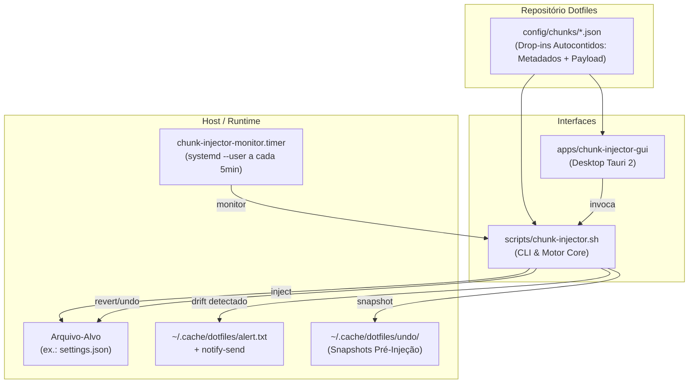
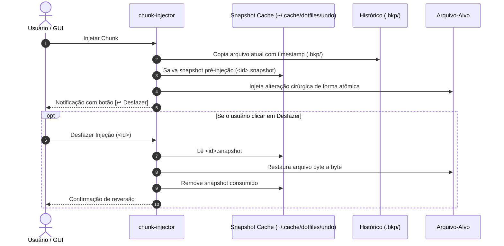

# 💉 Chunk Injector & GUI

> Gerenciador declarativo para injeção, verificação, monitoramento contínuo e reversão cirúrgica de trechos de configuração (*chunks*) em arquivos que não suportam symlinks integrais.


---

## 🎯 Por que o Chunk Injector Existe?

Nos dotfiles tradicionais, configurações são aplicadas via **symlinks** (`~/.gitconfig -> ~/dotfiles/data/gitconfig`). Porém, certas ferramentas modernas (como IDEs, CLIs de IA como o Antigravity, VS Code, navegadores) regravam seus arquivos de configuração dinamicamente durante o uso (ex.: `~/.gemini/antigravity-cli/settings.json`), quebrando symlinks ou sobrescrevendo alterações.

O **Chunk Injector** resolve isso:
1. Mantém os arquivos reais no host (sem forçar symlink frágil).
2. Injeta cirurgicamente apenas os blocos ou chaves que pertencem aos dotfiles.
3. Monitora silenciosamente a cada 5 minutos via `systemd --user`.
4. Alerta imediatamente se um aplicativo de terceiros remover o seu trecho.
5. Permite visualização em diff projetado e **desfazer com 1 clique**.

---

## 🗺️ Arquitetura do Sistema



---

## ⚡ Quick Start (Menos de 2 minutos)

### 1. Inspecionar o status atual
```bash
chunk-injector doctor
```

### 2. Injetar trechos ausentes
```bash
chunk-injector inject
```

### 3. Abrir a interface visual interativa
```bash
chunk-injector-gui
# ou pelo dotfiles-menu.sh -> opção "chunks gui"
```

### 4. Desfazer uma injeção
```bash
chunk-injector undo <id-do-chunk>
# ou clique em "↩️ Desfazer" diretamente na GUI
```

---

## 📚 Guia de Como-Fazer (How-To)

### Como cadastrar um novo trecho pela GUI
1. Abra o `chunk-injector-gui`.
2. Clique no botão **➕ Novo Chunk**.
3. Preencha:
   - **ID**: identificador único (ex.: `meu-plugin-config`).
   - **Tipo**: `json-key`, `block` ou `line`.
   - **Arquivo-Alvo**: caminho do arquivo (ex.: `~/.config/app/config.json`).
   - **Conteúdo do Trecho**: cole o JSON completo ou linhas a serem injetadas.
4. Clique em **Salvar Chunk**.
   > [!NOTE]
   > O chunk é gravado como um arquivo drop-in autocontido e versionado diretamente em `config/chunks/<id>.json`.

### Como inspecionar e revisar o Diff antes de aplicar
No painel inferior do `chunk-injector-gui`:
- As linhas verdes com prefixo `+` indicam o que será inserido no arquivo atual.
- As linhas vermelhas tachadas com prefixo `-` indicam linhas divergentes a serem corrigidas.
- Use o botão **⚡ Injetar Agora** no cabeçalho do diff para aplicar imediatamente.
- Se o trecho já estiver aplicado (`OK`), use o botão **↩️ Desfazer Injeção** para restaurar o estado anterior.

---

## 📖 Referência Técnica

### 1. Formato dos Chunks Drop-in (`config/chunks/<id>.json`)
Cada chunk é um arquivo JSON autocontido no diretório `config/chunks/`. O sistema descobre dinamicamente todos os arquivos `*.json` presentes.

```json
{
  "id": "agy-hud-statusline",
  "type": "json-key",
  "target": "~/.gemini/antigravity-cli/settings.json",
  "selector": ".",
  "description": "Statusline agy-hud no Antigravity CLI",
  "payload": {
    "statusLine": {
      "type": "command",
      "command": "~/.gemini/config/plugins/agy-hud/hooks/status-line.sh"
    }
  }
}
```

| Campo | Tipo | Obrigatório | Descrição | Exemplo |
| :--- | :---: | :---: | :--- | :--- |
| `id` | string | Sim | Identificador único (`^[a-z0-9][a-z0-9._-]*$`) | `"agy-hud-statusline"` |
| `type` | string | Sim | Estratégia: `"json-key"`, `"block"` ou `"line"` | `"json-key"` |
| `target` | string | Sim | Destino no host (aceita `~/` ou `$HOME/`) | `"~/.gemini/antigravity-cli/settings.json"` |
| `selector` | string | Sim | • `.` para mesclagem JSON na raiz<br/>• `#` para comentários em bloco<br/>• `-` para linha exata | `"."` |
| `description` | string | Não | Texto descritivo para alertas e listagens | `"Statusline agy-hud"` |
| `payload` | object/string | Sim | Conteúdo a ser injetado (objeto JSON para `json-key`, string para `block`/`line`) | `{ "statusLine": { ... } }` |

### 2. Estratégias de Injeção (`tipo`)

#### A. `json-key` (Mesclagem JSON declarativa)
- **Seletor `.` (Recomendado)**: O trecho é um objeto JSON completo (ex.: `{"statusLine": { ... }}`). O motor faz deep merge (`. * $chunk`) preservando todas as demais chaves do arquivo.
- **Seletor `.caminho` (Legado)**: Injeta o valor sob uma subchave específica do objeto alvo.

#### B. `block` (Bloco delimitado)
Garante a presença de um bloco de texto delimitado por marcadores:
```bash
# >>> chunk-injector:meu-bloco >>>
export MEU_AMB=1
alias foo="bar"
# <<< chunk-injector:meu-bloco <<<
```
O seletor define o caractere de comentário (`#`, `//`, etc.).

#### C. `line` (Linha literal única)
Garante a presença de uma linha exata no arquivo (verificado via `grep -Fxq`).

---

### 3. CLI — Comandos e Opções (`scripts/chunk-injector.sh`)

```bash
# Comandos principais
chunk-injector inject [opções]   # Injeta chunks ausentes ou divergentes
chunk-injector undo <id>         # Restaura arquivo ao estado pré-injeção
chunk-injector revert [opções]   # Reverte chunks (aceita --only <id>)
chunk-injector doctor            # Diagnóstico tabular read-only (exit 1 em drift)
chunk-injector monitor           # Execução periódica silenciosa (notificações)

# Opções suportadas
--only <id>       # Restringe a operação a um único chunk
--dry-run         # Simula operações sem modificar nenhum arquivo no disco
--no-systemd      # Impede a ativação automática do timer do systemd no inject
--no-notify       # Suprime disparos de notify-send no modo monitor
```

---

## 🛡️ Segurança, Backups e Desfazer (Undo)



> [!IMPORTANT]
> - **Substituição Atômica**: Todas as escritas utilizam `mktemp` no mesmo diretório do arquivo-alvo, seguido de `chmod --reference` e `mv -f`, garantindo que arquivos nunca fiquem corrompidos em caso de interrupção.
> - **Restauração Fiel**: O `undo` restaura exatamente o conteúdo prévio, preservando comentários, indentação e formatação que existiam antes da injeção.

---

## 🖥️ Integrações no Ambiente

- **Zsh**: O arquivo [`data/.zsh/chunk-injector.zsh`](file:///home/max/dotfiles/data/.zsh/chunk-injector.zsh) verifica `~/.cache/dotfiles/chunk-injector-alert.txt` no carregamento de novos terminais e exibe aviso caso algum trecho tenha sido perdido.
- **TUI Menu**: Opção `chunks` disponível no menu interativo [`dotfiles-menu.sh`](file:///home/max/dotfiles/dotfiles-menu.sh).
- **Desktop Launcher**: Entrada `.desktop` instalada em `~/.local/share/applications/chunk-injector-gui.desktop` para acesso nativo via KRunner / Menu de Aplicativos do KDE Plasma.
