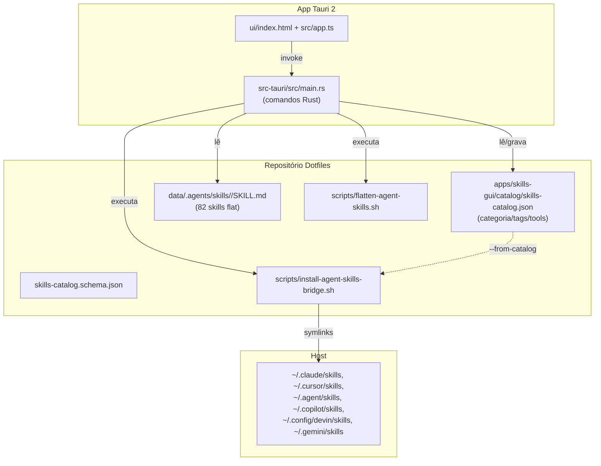

# 🧩 Skills GUI

> Gerenciador desktop (Tauri 2) do acervo de agent skills dos dotfiles: organização por categoria/tags, saúde da
> estrutura flat, exposição por ferramenta (bridge) e abertura no editor.


---

## 🎯 Por que o Skills GUI Existe?

O acervo `~/.agents/skills` é **flat**: 82 diretórios, cada um com seu `SKILL.md`. Antes, a organização vivia em
15 *bundles* (diretórios sem `SKILL.md` agrupando sub-skills), o que escondia 68 skills das ferramentas que
escaneiam apenas um nível. O `scripts/flatten-agent-skills.sh` achatou o acervo; a organização passou para um
**catálogo versionado** de metadados.

O Skills GUI é a interface desse catálogo:

1. **Organiza** — categoria, tags, favoritas e notas por skill, sem tocar nos arquivos.
2. **Expõe** — escolhe em quais ferramentas a skill aparece via symlink (bridge).
3. **Audita** — estrutura flat, cobertura do catálogo, nomes divergentes e symlinks quebrados.
4. **Opera** — roda `flatten-agent-skills.sh --check` e o bridge (`--doctor`, `--dry-run`, apply) com um clique.

> [!IMPORTANT]
> O catálogo é a **fonte de verdade da organização**, não do conteúdo. Renomear uma skill continua sendo uma
> operação de `git mv` + ajuste do frontmatter — o catálogo usa o **nome do diretório** como id estável.

---

## 🗺️ Arquitetura



---

## ⚡ Quick Start

```bash
# Abrir a interface (compila na primeira vez)
skills-gui

# Menu principal
dotfiles-menu.sh   # digite: skills gui

# Recompilar o binário release
skills-gui --build
```

A janela abre com o acervo carregado do repositório resolvido por `DOTFILES_REPO_ROOT` (o launcher exporta) ou
por busca ascendente a partir do diretório atual/executável.

---

## 🗂️ Catálogo (`skills-catalog.json`)

Contrato em `apps/skills-gui/catalog/skills-catalog.schema.json`. Forma:

```json
{
  "version": 1,
  "updatedAt": "2026-11-10T15:00:00Z",
  "categories": [
    { "id": "devops", "label": "DevOps", "order": 70 }
  ],
  "skills": {
    "agents-md": {
      "category": "ai-config",
      "tags": ["agents", "config"],
      "tools": null,
      "favorite": false,
      "notes": ""
    }
  }
}
```

| Campo | Significado |
|---|---|
| chave de `skills` | nome do diretório em `~/.agents/skills` (id estável) |
| `category` | id de uma entrada em `categories`; `null` = **Sem categoria** |
| `tags` | lista livre, normalizada (trim, ordenada, sem duplicatas) |
| `tools` | ferramentas que recebem o symlink via bridge; `null` = **todas**; `[]` = nenhuma |
| `favorite` | estrela na UI |
| `notes` | anotação interna (não vai para o `SKILL.md`) |

Ferramentas válidas: `claude`, `devin`, `antigravity`, `copilot`, `cursor`, `gemini`.

### Categorias

As 16 categorias iniciais vieram dos bundles achatados (`ai-config`, `ai-ecosystem`, `code-quality`, `curso`,
`cursor-ide`, `debugging`, `devops`, `dotfiles`, `implementation`, `k-flow`, `k1-refinement`, `product`,
`tech-domain`, `testing`, `utilities`) + `uncategorized`. A UI cria, edita e exclui categorias; excluir move as
skills para **Sem categoria** (nunca apaga skill).

---

## 🖥️ Interface

- **Sidebar** — visões (todas, favoritas, sem categoria, nome divergente), categorias com contagem, tags e
  ferramentas (exposição via bridge).
- **Busca** — nome, nome de exibição, descrição, notas, categoria e tags.
- **Cards** — descrição, categoria, tags, ferramentas, favoritar, tamanho/contagem de arquivos e data.
- **Seleção múltipla** — mover várias skills para uma categoria de uma vez.
- **Drawer** — edita categoria/tags/tools/favorita/notas, mostra o `SKILL.md` e abre a pasta ou o arquivo no
  editor padrão (`xdg-open`).
- **Saúde** — mesmas checagens do `flatten-agent-skills.sh --check`, em painel.
- **Bridge** — `doctor`, `dry-run` e apply com saída completa em modal.

### Ordenação e filtros

`Nome A→Z`, `Mais recentes`, `Categoria`, `Mais arquivos`. O filtro de ferramenta considera `tools: null` como
"todas" — e a UI avisa que **leitura nativa** (OpenCode, Codex, Cursor, Copilot) não é afetada.

---

## 🔗 Integração com o bridge

O botão **Aplicar bridge** executa:

```bash
scripts/install-agent-skills-bridge.sh --from-catalog
```

Com `--from-catalog`, as specs `*`/`**` do `config/agent-skills-bridge.list` passam a respeitar o campo `tools`
do catálogo; links gerenciados fora do conjunto permitido são removidos. Specs explícitas (`<nome>`) vencem o
catálogo. Sem a flag, o bridge continua expondo todas as skills (compatibilidade).

Detalhes de guardrails, manifest do Antigravity e diagnóstico em [`docs/agent-skills-bridge.md`](agent-skills-bridge.md).

---

## 🔒 Segurança

- O backend só escreve **no catálogo**; nenhum comando apaga arquivos de skill.
- `save_skill_meta` valida que o diretório existe e tem `SKILL.md` (rejeita `/`, `\`, `..`).
- `save_category` restringe o id a `a-z`, `0-9` e `-`.
- `open_path` só abre caminhos canônicos dentro do repositório ou do acervo.
- Escrita do catálogo é atômica (arquivo temporário + rename).
- O apply do bridge mantém os guardrails do script: backup em `.bkp/`, nunca `rm -rf`, nunca toca diretórios
  reais divergentes.

---

## 🧪 Validação

```bash
# Estrutura flat + cobertura do catálogo (exit 1 se houver pendência)
scripts/flatten-agent-skills.sh --check

# Bridge filtrado pelo catálogo (exit 1 se houver drift)
scripts/install-agent-skills-bridge.sh --doctor --from-catalog

# Diagnóstico sem abrir a janela (útil quando a grade aparece vazia)
apps/skills-gui/src-tauri/target/release/skills-gui --print-repo
apps/skills-gui/src-tauri/target/release/skills-gui --print-skills

# Typecheck do frontend
tsc -p apps/skills-gui/tsconfig.json

# Build do binário
skills-gui --build
```

### Resolução do repositório

O backend procura a raiz nesta ordem: `DOTFILES_REPO_ROOT` (exportado pelo launcher) → diretório
atual e seus pais → diretório do executável e seus pais → `~/dotfiles`. Um diretório só é aceito se
tiver `data/.agents/skills` **e** um dos marcadores do repo (`apps/skills-gui/catalog` ou
`config/agent-skills-bridge.list` + `scripts/install-agent-skills-bridge.sh`) — sem essa checagem,
`apps/skills-gui` (que também tem `catalog/`) seria confundido com a raiz.

Se a grade aparecer vazia, o app mostra um painel com o caminho tentado; `--print-repo` imprime
`repo_root`, `skills_dir` e `catalog` sem abrir a janela.

---

## 📁 Arquivos envolvidos

| Caminho | Papel |
|---|---|
| `apps/skills-gui/catalog/skills-catalog.json` | catálogo versionado (fonte da organização) |
| `apps/skills-gui/catalog/skills-catalog.schema.json` | contrato JSON Schema |
| `apps/skills-gui/src-tauri/src/main.rs` | comandos Tauri (catálogo, saúde, scripts) |
| `apps/skills-gui/src/app.ts` | frontend TypeScript (compila para `ui/app.js`) |
| `apps/skills-gui/ui/` | HTML/CSS/JS carregados pela janela |
| `data/.local/bin/skills-gui` | launcher (compila o frontend e o binário quando necessário) |
| `data/.local/share/applications/skills-gui.desktop` | entrada no menu de aplicações |
| `scripts/flatten-agent-skills.sh` | migração/checagem da estrutura flat |
| `scripts/install-agent-skills-bridge.sh` | bridge (`--from-catalog`, `--doctor`, `--dry-run`) |
| `config/agent-skills-bridge.list` | escopo por ferramenta |
